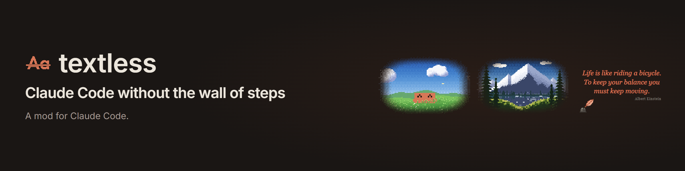
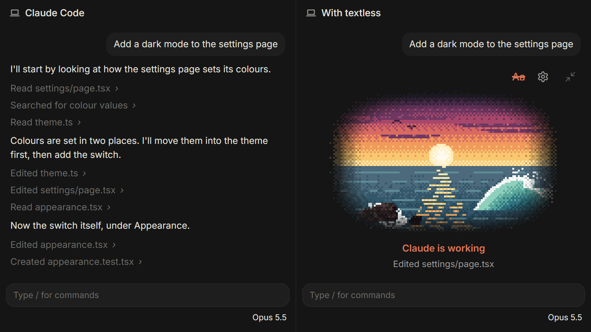
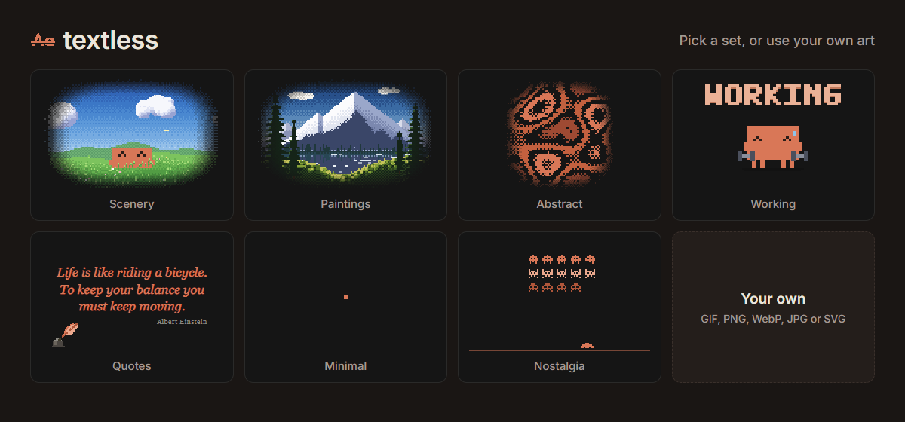

**textless** is a Claude Code mod for the Claude desktop app (not the terminal). While Claude works, the chat shows one piece of art instead of every step: a scene, an
animation, a quote, a scene someone else made, or a game of chess. When Claude is done, the chat is back as normal and
the steps are one click away under "show steps".

## Install

    claude plugin marketplace add HeyCubit/effortless
    claude plugin install textless@effortless

Then run `/reload-plugins`. Website, scenes and Marketplace: https://heycubit.github.io/effortless/textless/

## What you get

- **One switch.** The Aa on the card turns textless off for that chat (struck through means the steps are hidden). The
  gear opens the settings, and the arrows fold the card to one line and back.
- **Sets.** Clawd, Scenery, Paintings, Abstract, Minimal, Nostalgia, Working and 200 Quotes, or your own GIF, PNG, WebP,
  JPG or SVG in `~/.claude/textless/scenes`. Build your own sets and star favourites on the settings page.
- **Marketplace.** Share a scene, star the ones you like, put one on with `/textless get <id>`. Uploads are checked
  before they go live.
- **Chess.** `/chess` plays a built-in opponent with four levels and piece sounds, `/chess claude` plays against Claude,
  `/chess end` closes the board. It remembers where you were.

## Commands

`/textless` toggles it. `on`, `off`, `settings`, `set <name>`, `next`, `get <id>`, `folder`, `update` and `debug` do what
they say. `/chess`, `/chess claude` and `/chess end` run the chess board.

## Status

A hobby project. Not made by or affiliated with Anthropic. The code is MIT, see the root [LICENSE](../LICENSE).
